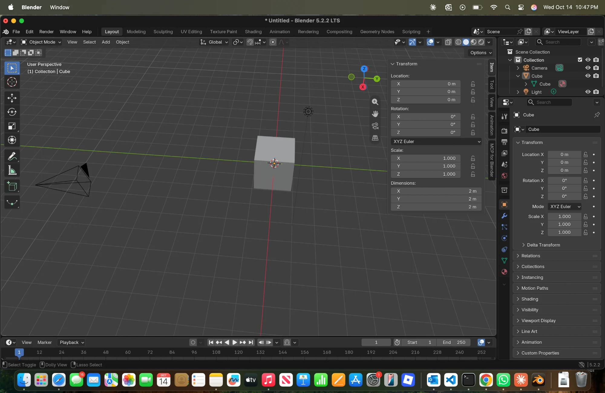

# BLENDER-NOTES — learning the window

*Blender 5.2.2 LTS on macOS 15.6 · 2026-10-14*

> **Authorship:** Claude drafted the six descriptions below at my request, from my two screenshots. The **"What I noticed"** lines are mine, written after my own session of orbiting, panning, zooming and switching modes. Recorded in FRICTIONAL.md and SOURCES.md.

*My own screenshot, 2026-10-14 22:47.*

## 1. 3D viewport

The large central area where the scene is drawn and edited. The label in its top-left corner gives the view ("User Perspective", "Right Orthographic") and the active object ("Collection | Cube"). Middle-drag orbits the view, Shift + middle-drag pans it, and the scroll wheel zooms. The red line is the X axis and the green line is Y. Z points up: **Blender is Z-up**, which matters when the asset goes to Y-up Godot.

- **What I noticed:**

## 2. Toolbar

The column of icons down the viewport's left edge: Select, Cursor, Move, Rotate, Scale, Transform, Annotate, Measure, and Add Cube. It picks what a left-click-drag does in the viewport. It does not show numbers; for exact values I use the sidebar.

- **What I noticed:**

## 3. Outliner

The tree in the top right that lists everything in the scene: Scene Collection → Collection → Camera, Cube, Light. Expanding Cube shows its mesh data, a separate item also called "Cube". Clicking a name selects that object, and the eye icon hides it from the viewport. This is where I will check that each asset file contains only the parts I meant to build.

- **What I noticed:**

## 4. Properties editor

The bottom-right panel with a vertical strip of tabs (render, output, scene, world, object, modifiers, physics, constraints, data, material). The orange-square **Object** tab shows the active object's Transform. The **Material** tab, the red sphere at the bottom of the strip, is where the flat colours will go.

- **What I noticed:**

## 5. Sidebar (N)

Press **N** in the viewport to toggle it. Its **Item** tab shows the active object's Location, Rotation, Scale and **Dimensions**. Dimensions are the real size in metres; scale is only a multiplier. The default cube reads **Scale 1.000 but Dimensions 2 m × 2 m × 2 m**, so "scale 1" does not mean "1 metre". I will read each asset's size for TEST-REPORT here. The sidebar also has the **MCP for Blender** tab, which showed "Connected on port 9876".

- **What I noticed:**

## 6. Mode selector

The drop-down at the left of the viewport header, reading **Object Mode**. Object Mode moves, rotates and scales whole objects. **Edit Mode** (Tab) edits the object's own vertices, edges and faces. Moving geometry in Edit Mode changes where the mesh sits relative to its origin, the small orange dot, without moving the origin itself. That is one way an asset ends up floating or sunk in Godot.

- **What I noticed:**
