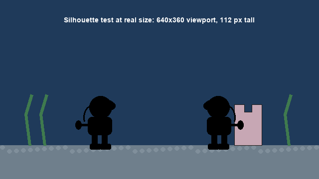
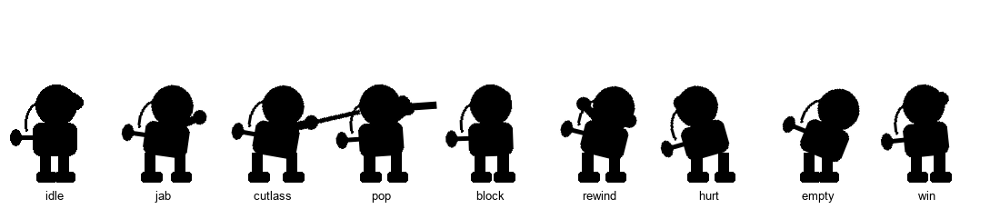
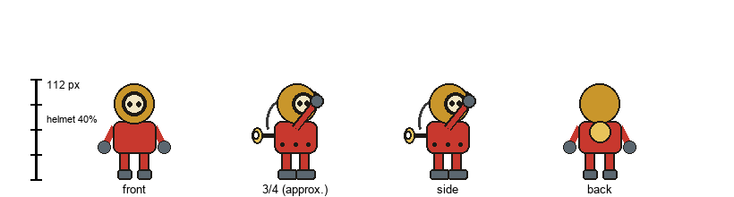
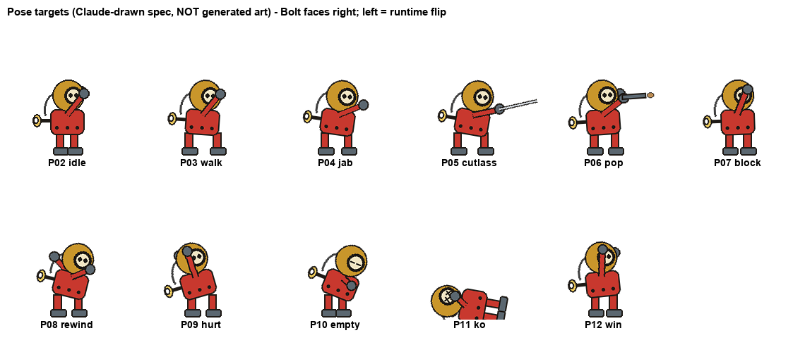
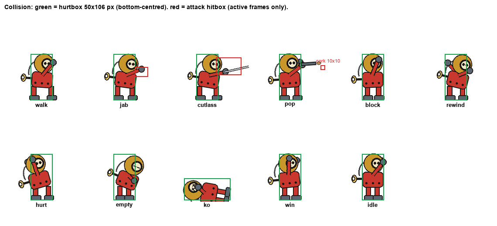
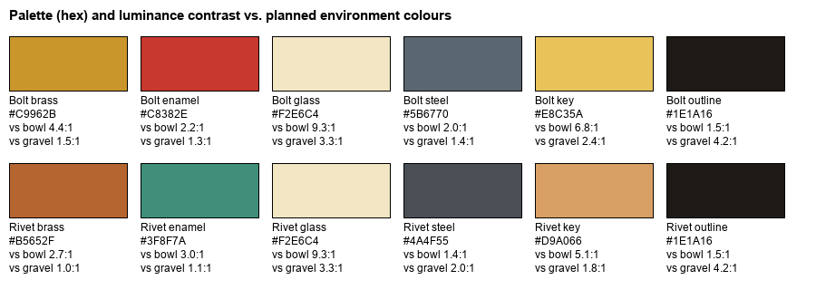
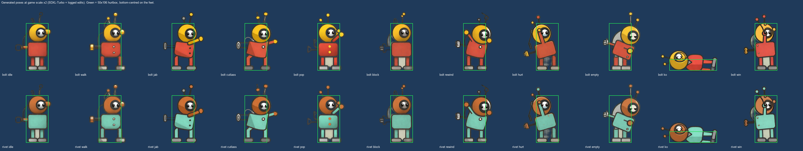

# Character sheet — Bolt

*Version 1 · 2026-10-05 · committed before any generation. The images in this version are **Claude-drawn code sketches** (`design/draw_design.py`), used as the specification. Generated poses are added later under "Revisions" and judged against this sheet; this version is not rewritten.*

- **Concept in one sentence:** Bolt is a chunky tin wind-up deep-sea-diver toy (a huge brass helmet with a round porthole face, a red enamel suit, steel lead boots, and a winding key on his back) who boxes other tin toys at the bottom of an empty goldfish bowl.
- **Opponent:** Rivet is the same toy repainted (copper helmet, verdigris suit). Rivet is made by **recolouring** Bolt's accepted poses, not by generating a second character; every recolour is logged as an edit.

## Silhouette at on-screen size

- **Viewport:** 640×360, scaled ×2 to a 1280×720 window (×6 = 3840×2160 for film capture).
- **On-screen height:** Bolt is **112 px tall** in the viewport (31 % of screen height, a typical fighting-game scale).
- **What must read in solid black:** the round helmet (largest shape), the winding key sticking out of the back (tells you which way he faces), and the blocky boots. Facing must be readable from the key alone.

## Facing and orientation

- **Drawn:** facing **right** (profile / slight three-quarter, the side view the camera sees).
- **Left:** horizontal flip at runtime (`Sprite2D.flip_h`). The key and air hose flip with him, so his back is always away from the opponent.
- **Rivet** starts facing left (the same right-facing art, flipped and recoloured).
- **Not generated:** left-facing art, front and back views for gameplay (the turnaround is reference only).

## Reference turnaround (P01)

Front, three-quarter, side and back at the same height, with a 112 px height bar. The generated **reference image** must match these proportions; every later pose is checked against the accepted reference, not against the text prompt.

## Poses (12, each a single static image for one game state)

| # | Pose | Game state | What it must show | In slice? |
|---|---|---|---|---|
| P01 | Reference turnaround | — (reference) | Locks proportions; helmet ≈ 40 % of height | reference |
| P02 | Idle / fight stance | `IDLE` | Gloves up, weight centred, key visible behind | ✅ |
| P03 | Walk | `WALK` | One clear stride, slight forward lean | ✅ |
| P04 | Jab | `ATTACK_JAB` | Front fist fully extended at chest height | ✅ |
| P05 | Cutlass swing | `ATTACK_CUTLASS` | Arm extended forward-and-down after the swing; blade is a separate sprite | ✅ |
| P06 | Pop-gun fire | `ATTACK_POP` | Arm straight out level, slight backward recoil lean | ✅ |
| P07 | Block | `BLOCK` | Both gloves raised in front of the porthole | ✅ |
| P08 | Rewind | `REWIND` | Hunched forward, back arm reaching behind to crank the key | ✅ |
| P09 | Hurt | `HURT` | Knocked backwards, helmet tilted back | ✅ |
| P10 | Spring empty | `EMPTY` | Slumped forward, arms hanging, eyes half-closed in the porthole | ✅ |
| P11 | Knocked out | `KO` | Flat on his back, X-eyes in the porthole | ✅ |
| P12 | Victory | `WIN` | One glove raised high, chest out | ✅ |

**Props (separate sprites, attached to a per-pose hand anchor at runtime):** `WPN-CUTLASS` (tin cutlass, blade ≈ 0.45 × Bolt's height), `WPN-POPGUN` (tin cork pop-gun, ≈ 0.30 × height), `PROP-CORK` (projectile, 10 × 10 px). Weapons are generated once and **not baked into poses**, so 12 poses + 3 props are 15 images, not 12 × 3. The hand-anchor offset for each pose is measured after generation and recorded in the Revisions section.

## Collision overlay

- **Hurtbox:** one rectangle, **50 × 106 px**, bottom-centred on the feet, the same in every standing pose. KO uses the same box rotated (it no longer matters, because no hits register during KO).
- **Attack hitboxes** (active only during the attack's active window):
  - Jab: 30 × 22 px, offset (+24, −76) from the feet.
  - Cutlass: 58 × 40 px, offset (+20, −98).
  - Pop-gun: a 10 × 10 px cork projectile spawned at the muzzle.
- **Art beyond the hurtbox, and why it is fair:**
  - **The winding key and air hose** stick out about 16–20 px behind the back. They are **not** hittable. Hits from behind cannot happen in a 1-on-1 where you always face the opponent, and making the key hittable would punish the player for the prop that tells them their facing.
  - **Extended fists, cutlass and gun** reach past the hurtbox. Attackers don't get extra hurtbox on their extended limbs (common practice for readability). This favours the attacker slightly, which suits a game where every attack costs wind.
  - **The helmet's front curve** pokes about 4 px past the box in some poses. That's under 4 % of the width, and invisible in play.

## Palette

| Role | Bolt | Rivet (recolour) |
|---|---|---|
| Helmet | `#C9962B` brass | `#B5652F` copper |
| Suit | `#C8382E` red enamel | `#3F8F7A` verdigris |
| Porthole glass | `#F2E6C4` | `#F2E6C4` |
| Boots / gloves | `#5B6770` steel | `#4A4F55` dark steel |
| Key | `#E8C35A` bright brass | `#D9A066` |
| Outline | `#1E1A16` | `#1E1A16` |

**Checked against the planned environment** ([contrast-table.md](design/character/contrast-table.md)), as luminance contrast vs. the bowl interior `#1F3A5A` and the gravel `#6F7F8C`:
- Bolt reads by his **helmet (4.4:1), key (6.8:1) and porthole (9.3:1)** against the bowl. Those three shapes carry the silhouette.
- **Problem found before generating:** the dark outline (1.5:1) and steel boots (2.0:1) nearly vanish against the dark bowl, and **Rivet's copper helmet and verdigris suit are only 2.7–3.0:1**. Rivet's suit against the gravel is **1.07:1**, which effectively disappears. Decisions:
  1. The background must keep a **lighter band behind the fighters' height zone** (moonlight on the back glass), and the gravel must be lighter or warmer than planned.
  2. Prompts ask for a **thin light rim light** on the fighters.
  3. This is logged as predicted failure **F4** in CHANGE-BRIEF and re-measured on the real generated background.

## Consistency rules (every generated pose is judged against these)

1. **Proportions:** helmet diameter ≈ 40 % of total height. Torso ≈ 32 %, legs + boots ≈ 28 %. A pose fails if the helmet is under 33 % or over 47 %.
2. **Porthole:** one round porthole, on the front of the helmet, with exactly **two eyes** visible through it at the same height. No mouth, no nose, no second window.
3. **Winding key:** always on the **back**, at chest height, a flat two-lobed key. Never missing, never on the front.
4. **Outline weight:** one consistent dark outline, about 2 px at game size.
5. **Materials:** helmet is brass metal, suit is red painted tin with rivets. Never fabric, never rubber.
6. **Hands:** simple round mitten gloves (steel). No fingers, which avoids hand artefacts.
7. **Facing:** profile facing right. A generated pose facing left is mirrored before use and noted as an edit.
8. **Background:** generated on a flat solid colour, then removed. Never prompted as "transparent".

## Revisions

*(none yet — generated poses will be added here with their asset-log IDs)*

### Revision 1 — 2026-10-06: generated poses (ASSET-LOG CHAR-REF, CHAR-*)

- **Accepted reference:** CHAR-REF v6 s40, with painted eyes (`raw/edits/CHAR-REF-eyes.png`; finalists in `design/rejected/CHAR-REF-finalists.jpg`). It adds **two antennae** (a short brass stalk and a taller red-ball stalk). They are now part of the consistency rules and are copied into every pose init.
- **Poses:** SDXL-Turbo img2img from the spec sketches, at strength 0.6, seed 43 (win: seed 42).
- **Rule 3 changed:** the winding key is now a **separate sprite** (`PROP-KEY`) at a per-pose back anchor (`godot/assets/fighters/anchors.json`). Code spins it during rewind, because the generated art drew a nozzle there instead of a key.
- **Rule 2 met by an edit:** two eyes are painted on every pose (half-closed for EMPTY, X for KO).
- **Facing changed:** the v1 sheet assumed Bolt always faces the opponent. In the slice, **facing follows the walk input**, as the assignment requires and the left art is a runtime flip. Walking away turns your back, and a block only works facing the attacker. That makes "back off to rewind" a real risk. The note that "hits from behind cannot happen" no longer holds: hits from behind land on the same 50×106 hurtbox. The key's overhang behind is still not hittable.
- **Silhouette re-test** with generated art on the real background: `design/character/silhouette-generated-in-game.png`. The helmet, antennae and boots read; facing is weaker without the key (TEST-REPORT section 2).
- **Palette re-check** on the real background: `evidence/contrast-F4-recheck.txt`. Rivet's suit is 2.35:1. Bolt's helmet vs. the pink castle is 1.02:1, which is a limitation.
