# Tin Knockout

### Game Design Document · *tin toys fight after closing time*

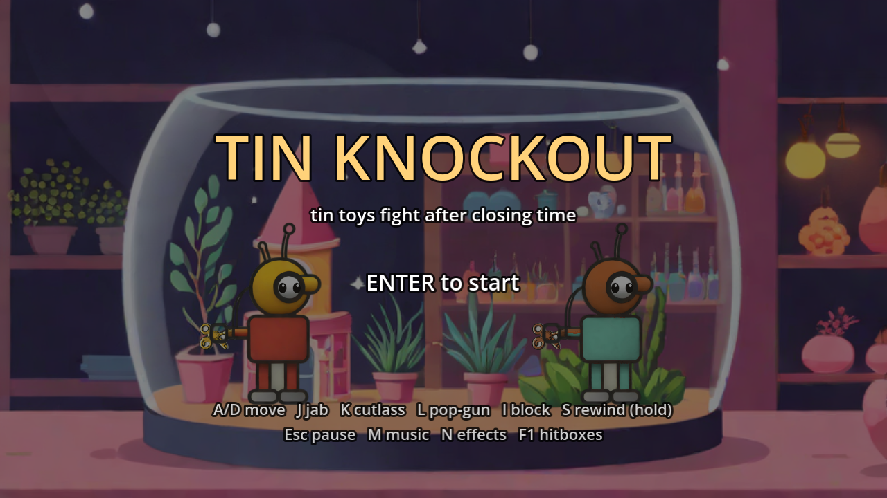

| | |
|---|---|
| **Course** | CSYE 7270 · Fall 2026 · Create a Game Design Document |
| **Author** | Tharun Maheswararao · maheswararao.t@northeastern.edu |
| **Version** | 1.0 · 2026-10-19 |
| **Engine** | Godot 4.7.2 (GDScript, GL Compatibility renderer) |
| **Repository** | [github.com/Tharun-Maheswararao/walker-tinknockout-tharun-m](https://github.com/Tharun-Maheswararao/walker-tinknockout-tharun-m) |

> **How to read this document.** This is the design for the whole game I want to build in this class. Part of it already runs: the Assignment 2 slice (Bolt vs Rivet in the goldfish bowl) and the Assignment 3 props. Those parts are marked **Built**, and their numbers are copied from the code (`godot/fighter/fighter.gd`). Everything else is marked *Planned*, and its numbers are starting values that playtests will tune.

## Contents

1. [Name of the Game](#1-name-of-the-game)
2. [Concept](#2-concept)
3. [Game Flow](#3-game-flow)
4. [Game Elements and Assets](#4-game-elements-and-assets)
5. [Main Characters](#5-main-characters)
6. [Story](#6-story)
7. [Gameplay](#7-gameplay): goal, mechanics, abilities and power-ups, levels, losing and restarting, player skills
8. [Graphics and Styling](#8-graphics-and-styling)
9. [Music and Sound Effects](#9-music-and-sound-effects)
10. [Technical Description](#10-technical-description)

---

## 1. Name of the Game

### Tin Knockout

*Tagline: "tin toys fight after closing time."*

The name says the two things a player needs to know before pressing a key: the fighters are made of **tin** (you hear it in every hit), and you win by **knockout**. It is also a small joke. A wind-up toy that has been "knocked out" has simply run down, and running down is the main danger in this game.

---

## 2. Concept

**In two sentences:** You are **Bolt**, a tin wind-up deep-sea-diver toy who fights other tin toys in a toy shop after closing time. Every punch, cutlass swing and cork-gun shot unwinds the spring in your back, so you win by spending wind wisely and rewinding only when it is safe.

| | |
|---|---|
| **Genre** | 2D side-view, one-on-one fighting game with a stamina economy |
| **Players** | 1 player (story ladder vs computer opponents) · 2 players local (Versus) |
| **Platform** | Desktop: macOS and Windows, keyboard or gamepad. Web export is a stretch goal. |
| **Audience** | Players aged about 10 and up who like short, readable fights. Cartoon toy violence only: nothing bleeds or breaks, tin just rattles. |
| **Session** | A round is under 60 s. A bout (best of 3) is 1–3 minutes. The story is six nights, about 30 minutes. |
| **Camera** | Fixed side view of one arena, 640×360 pixels, scaled to the window |
| **Comparable games** | *Punch-Out!!* (one opponent at a time, readable tells, a ladder of characters) · the stamina bar of *Dark Souls* · the "toys come alive at night" story found in many children's books and films |

### The hook: your stamina is a spring, and you can hear it

Most fighting games give you a health bar and let you attack for free. In Tin Knockout **every action costs wind**, including walking. The only way to get wind back is to stop, hold **Rewind**, and crank the key on your back. While you crank, you stand still with your guard down, and a hit does 1.5× damage and knocks you over. Each quarter-turn of the key makes one ratchet **click** worth 10 wind, so a good player can count their wind by ear without looking at the dial.

One full spring can't knock out a full-health opponent. With 100 wind the best you can deal is about 59 damage (88 if every hit lands while they are stalled). So **every round forces at least one rewind**, and the fight becomes a series of small bets: *spend now, or step back and wind?*

### Design pillars

| Pillar | What it means in play |
|---|---|
| **1. Every move costs wind** | The spring is the whole strategy. The player must always know how much wind is left, and spending it must always be a choice. |
| **2. Tin you can hear** | Every contact is a material: brass, tin, cork, glass. Each attack has its own sound, and so does the spring. |
| **3. Read the fight at a glance** | Everything that matters is visible with the sound off: one clear pose per state, the porthole face, hit sparks, the dials. Sound only confirms. |
| **4. Toys after closing** | Playful, with a little night-time eeriness. The toys move only when nobody is watching, and the music sounds like it is coming from a music box on the next shelf. |

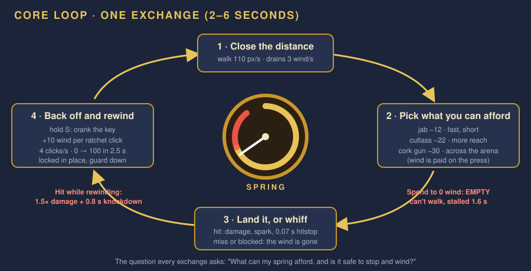

*Figure 1. The core loop. One exchange takes 2–6 seconds and always ends with the same question: what can my spring afford, and is it safe to stop and wind?*

---

## 3. Game Flow

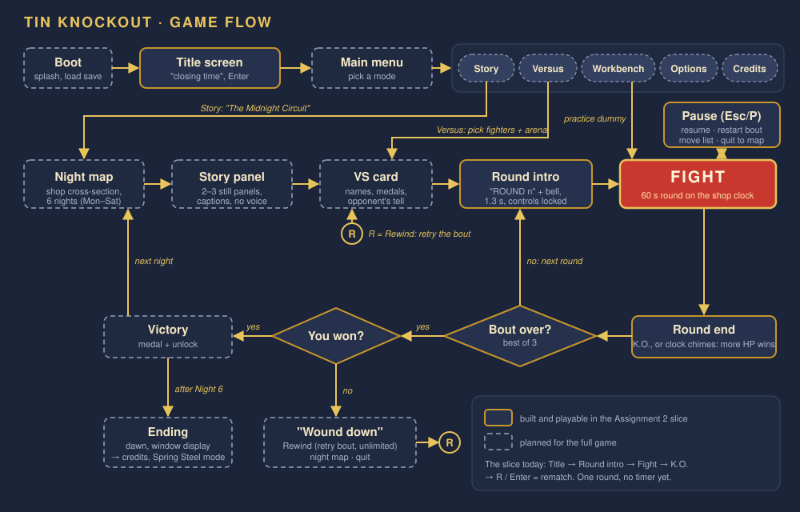

*Figure 2. Game flow from boot to ending. Solid boxes run in the slice today; dashed boxes are planned.*

### Screen by screen

| Screen | What the player sees | What the player does | Status |
|---|---|---|---|
| **Title** | The shop at night, the goldfish bowl, Bolt and Rivet standing still, the waltz playing quietly (−14 dB) | Enter to start | **Built** |
| **Main menu** | Five options on a shelf label: Story, Versus, Workbench, Options, Credits | Pick a mode | *Planned* |
| **Night map** | A cross-section of the shop with six lit arenas, one per night (Figure 9), the medals won so far, and the window display growing as toys join | Pick the next night, or replay a won night | *Planned* |
| **Story panel** | 2–3 still panels in the storyboard style, one caption each | Enter to skip or continue | *Planned* |
| **VS card** | Bolt and the opponent, their names, and the opponent's "tell" in one line (for example "Clatter: the drum blocks everything in front") | Enter | *Planned* |
| **Round intro** | "ROUND 1", the bell. Controls stay locked for 1.3 s. | Wait | **Built** |
| **Fight** | The arena, both fighters, the HUD (Figure 12) | Fight (Section 7.2) | **Built** (no clock yet) |
| **Pause** | Music muffled under a low-pass filter and 10 dB quieter, as if heard from underwater | Resume, restart bout, move list, quit to the map | **Built** (resume only) |
| **Round end** | "K.O.", the bell, the music stops dead, the winner's victory pose | Wait; the next round starts automatically | **Built** (one round) |
| **Victory** | Medal (Brass, Silver or Gold) and what was unlocked | Enter → night map | *Planned* |
| **"Wound down"** (loss) | Bolt slumped, half-closed eyes | **Rewind** (retry the bout), night map, or quit | *Planned* (the slice uses R for rematch) |
| **Ending** | Dawn panels, credits | Credits, then Spring Steel mode unlocks | *Planned* |

### Round and bout rules

- A **bout** is best of 3 rounds. Health and wind refill between rounds.
- A **round** ends when a fighter's health reaches 0 (K.O.), or when the **shop clock** on the HUD completes one 60-second lap. On time-out, the fighter with the higher health percentage wins. A tie goes to a sudden-death round with no clock.
- **Versus** uses the same rules with any two unlocked fighters on any unlocked arena.
- **Workbench** is practice: a dummy you can set to idle, block, rewind or copy any opponent's pattern, with hitboxes (F1) and frame data on screen.

### A typical night, start to finish (about 4–5 minutes)

Night map (10 s) → two story panels (20 s) → VS card (5 s) → three rounds of 40–60 s with the bell and the 1.3 s intro between them → Victory screen with a medal (10 s) → back to the night map, where the newly freed toy now stands in the shop window.

---

## 4. Game Elements and Assets

### Game objects (what exists in an arena while you play)

| Object | What it does | Status |
|---|---|---|
| **Fighters** (2) | One player-controlled, one computer- or player 2-controlled. Health 100, a spring (wind), a 50×106 px hurtbox, attack hitboxes. | **Built** |
| **Projectiles** | Corks from the pop-gun: 10×10 px, 320 px/s, live 2 s, one per press. Planned: darts, Clatter's thrown drumsticks, the Ringmaster's top hat. | **Built** (cork) |
| **Arena bounds** | The fighters can't leave the arena (in the bowl: x 132 to 500, 368 px wide), and tin bodies can't pass through each other (they stay at least 44 px apart). | **Built** |
| **Toy box** | Sits at the back of each arena. Every 20 seconds its lid pops open and throws out one pickup (Section 7.3). | *Planned* (3D model built) |
| **Pickups** | Winding key, oil can, mallet, shield, dart pistol, Golden Key. Walk over one to take it. | *Planned* |
| **Hazards** | One per arena from Night 2: marching soldiers, the cat's paw, the music-box floor, the train, carousel horses. Each is telegraphed for at least 1.5 s before it hits. | *Planned* |
| **HUD** | Health bars, spring dials, names, round text, pause and mute icons. Planned: the shop clock, pickup-use pips, medal row. | **Built** (partly) |

### Asset list

| Category | Built (in the repository) | Planned for the full game |
|---|---|---|
| **Fighter art** | Bolt: 1 reference + 11 poses, one static image per state. Rivet: the same 11 poses recoloured. Stored at 3× game size with `anchors.json` (feet, hands, key). | 5 more fighters × 11 poses = 55 images, plus one reference each |
| **2D props** | Tin cutlass, cork pop-gun, cork, winding key (Bolt and Rivet colours) (Figure 3) | Tin mallet, tin shield, spring-dart pistol, dart, oil can, Golden Key |
| **Environments** | The goldfish bowl on the shop counter (one 768×432 painted background) | 5 more arenas, each with 2–3 parallax layers |
| **3D props** | Sunken-castle ornament, winding key, toy box (`.glb`, built in Blender in Assignment 3) (Figure 4) | Rendered to 2D sprites at the fight camera's angle so they sit in the 2D arenas |
| **Sound effects** | 6: round bell, jab clang, cutlass shing, cork pop, rewind ratchet click, spring-empty *wrrr-clunk* | About 20 more (Section 9) |
| **Music** | 1 seamless waltz loop | Title theme, 6 arena loops, win and lose stings |
| **UI** | Code-drawn HUD: bars, dials, labels, pause and mute icons | Menus, night map, VS cards, story panels, shop clock, medal icons |
| **VFX** | Hit spark, 0.07 s hitstop, screen shake, 5° camera roll on a knockdown | Spring "sproing" coil, oil drips, rain on glass, toy-box confetti |
| **Story** | 7-panel storyboard (design reference) | About 16 story panels across six nights and the ending |

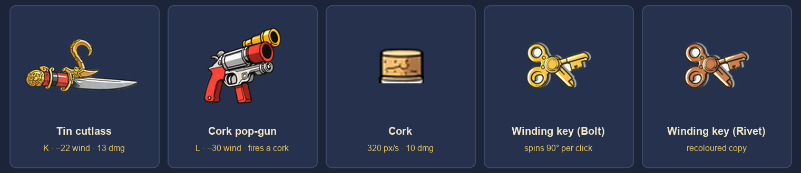

*Figure 3. The 2D props in the slice. Weapons are separate sprites attached to a per-pose hand anchor, so adding a weapon never multiplies the pose count.*

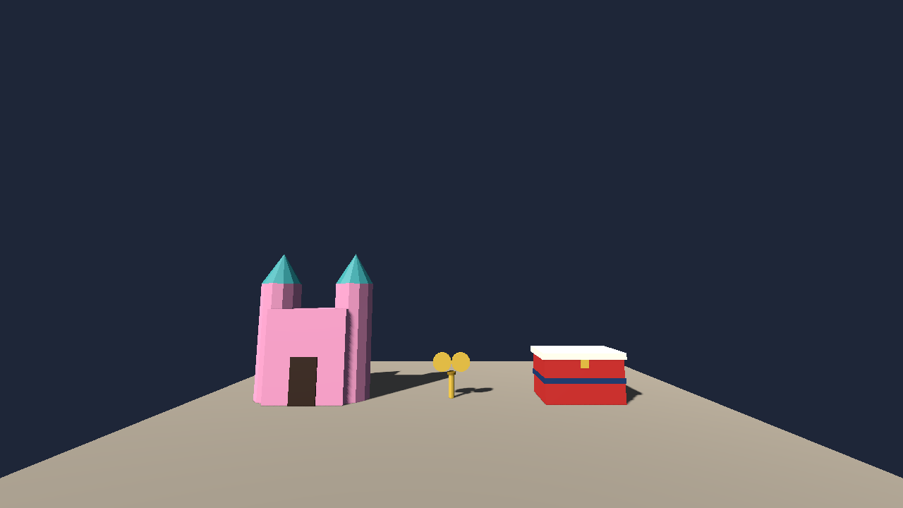

*Figure 4. Assignment 3 props in Godot at character scale (Bolt is 1.80 m tall): the sunken-castle ornament, the winding-key pickup and the toy box.*

---

## 5. Main Characters

Every fighter is a wind-up tin toy with a key on its back, so every fighter plays by the same spring rules. What changes is the spring size, the moves, and one **tell**: something you can see before their big attack lands.

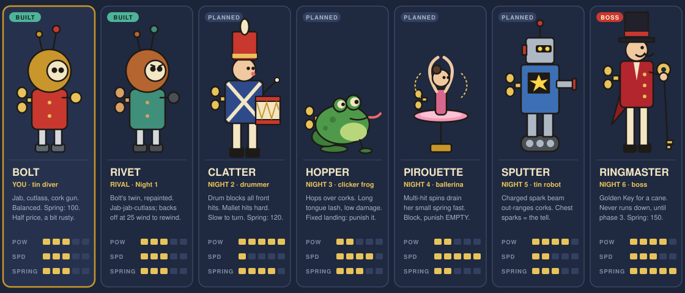

*Figure 5. The roster. Bolt and Rivet are built; the other five are code-drawn concept sketches showing silhouette, colours and role.*

### Bolt (the player character)

| | |
|---|---|
| **What he is** | A chunky tin deep-sea-diver toy: a huge brass helmet with one round porthole, a red enamel suit with rivets, steel lead boots, mitten gloves, two antennae, and a winding key on his back |
| **Personality** | Stubborn, hopeful, a little creaky. He has stood in an empty goldfish bowl on the counter for years with a half-price sticker on his helmet. He has no mouth and never speaks; his eyes in the porthole show everything he feels. |
| **Why he looks like this** | The round helmet is about 40 % of his height, the biggest shape in his silhouette, and easy to read at 112 px tall. The key always sits on his back, so you can tell which way he faces from the key alone. The round helmet was also easier for the image model to repeat across 11 poses than a more detailed design would have been. |
| **Colours** | Helmet `#C9962B` brass · suit `#C8382E` red enamel · glass `#F2E6C4` · boots and gloves `#5B6770` steel · key `#E8C35A` bright brass · outline `#1E1A16` |
| **Spring** | 100 wind · Health 100 · walks 110 px/s |
| **Moves** | Jab, tin cutlass, cork pop-gun, block, rewind; later hop and the "Depth Charge" special (Section 7.3) |

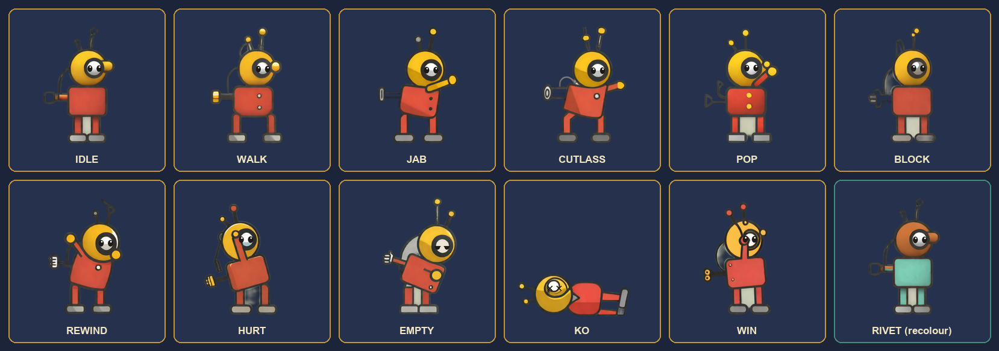

*Figure 6. Bolt's 11 poses, one static image per game state, swapped when the state changes and flipped at runtime to face left. Rivet (bottom right) is the same art recoloured. All poses are SDXL-Turbo output with logged edits.*

### Rivet (the rival)

Bolt's twin from the same factory box, repainted copper and verdigris years ago. Rivet thinks Bolt's plan is a fairy tale and works as the Ringmaster's doorman. He is the Night 1 opponent and the tutorial.

**Built pattern AI** (`fighter/rivet_brain.gd`, no randomness, so tests replay identically): walk in to about 64 px, then jab, jab, cutlass with 0.75 s between attacks; fire a cork from more than 230 px away when he has over 50 wind (not in the first 1.5 s of a round, then every 2.8 s at most); block every other jab or cutlass startup he sees within 90 px. When his wind drops **below 25** he walks away and rewinds until he is back to 90. That retreat is the lesson of Night 1: **punish the opponent who stops to wind.**

### The opponents

All values are planned starting points.

| Fighter | Toy | Night / arena | Spring | Signature move | The tell | How to beat them |
|---|---|---|---|---|---|---|
| **Clatter** | Tin drummer soldier | 2 · Toy Soldier Fort | 120 | **Drum guard**: blocks every front hit with no chip damage, but costs him 4 wind/s to hold. **Mallet**: 18 dmg. | The drumsticks rise before the mallet swing | Keep pressure on so he drums himself empty. Bait the mallet and punish its 0.45 s recovery. |
| **Hopper** | Tin clicker frog | 3 · Window Ledge | 100 | **Hop** over corks. **Tongue lash**: 90 px reach, 5 dmg, costs him 10. | His back legs fold before every hop | Don't fire corks blindly. Jab him during his fixed 0.3 s landing. |
| **Pirouette** | Music-box ballerina | 4 · Music Box | 80 | **Spin**: 3 hits × 4 dmg, costs her 25 | Her arms lift above her head | Block the spin; it drains her small spring fast. Punish her when she slumps EMPTY. |
| **Sputter** | Tin sparkler robot | 5 · Train Set | 100 | **Spark beam**: 1.0 s charge, 250 px reach, 15 dmg, costs him 40 | Sparks fill his chest window while he charges | Close the distance during the charge, or block it (20 % chip). |
| **The Ringmaster** | Tin circus ringmaster | 6 · Carousel (boss) | 150 | **Whip** (120 px, 9 dmg), **top-hat throw** (it comes back), and the **Golden Key** cane that keeps him wound | He taps the cane twice before a whip combo | Three phases (Section 7.4). In phase 3 the Golden Key falls into the arena: grab it first. |

### Supporting cast

- **The Shopkeeper:** never seen, only heard: the bell over the door, keys at dawn, footsteps upstairs. A reminder that the toys only live while nobody is watching.
- **Mothball:** the shop's old black cat, asleep on the window ledge. Not a fighter; the Night 3 hazard.
- **The cymbal monkeys:** two clockwork monkeys on the carousel who clash their cymbals in the boss fight's second phase.

All characters are original. No copyrighted characters are used, as the course requires.

---

## 6. Story

### Logline

In a toy shop that closes for good on Sunday, a half-price tin diver has six nights to fight his way up the shelves, win the Golden Key that never runs down, and wind every toy in the shop for one last, shop-saving night.

### The world and its one rule

**Pell's Toys & Curios** is a narrow corner shop with a bell over the door and a wall clock that runs a little slow. When the Shopkeeper locks up and the clock strikes midnight, the wind-up toys wake. But a toy only moves **while its spring has wind**. Run down, and you are just a toy on a shelf again until somebody winds you.

Every night the **Ringmaster**, the tallest toy on the top shelf, holds the **Midnight Circuit**: one bout on each shelf, climbing toward his carousel. The prize is a turn of the **Golden Key**, the old master key that came with the shop's music box. One turn of the Golden Key lasts a whole night. Nobody has beaten the Ringmaster in years, and he walks with the Key as his cane.

### The problem

On Monday a sign goes up in the window: **CLOSING DOWN — EVERYTHING MUST GO — SUNDAY.** Every toy in the shop will be boxed up and sold off by the lot.

Bolt has a plan. Win the Golden Key, then on Saturday night use it to wind **every toy in the shop at once**, and spend the night building a window display so wonderful that people stop, come in, and the shop stays open. To get there he has to climb the Circuit one shelf a night, Monday to Saturday.

### The six nights

| Night | Before the bout | After Bolt wins |
|---|---|---|
| **1 · Mon** · The Goldfish Bowl | The sign goes up. Bolt says he is entering the Circuit. Rivet laughs and blocks the only way out of the bowl. | Rivet lowers the ramp out of the bowl. "The stairs are guarded." |
| **2 · Tue** · Toy Soldier Fort | Clatter guards the building-block stairs: orders say no half-price toys past the fort. | Clatter's soldiers salute. One hands Bolt a tin mallet. |
| **3 · Wed** · The Window Ledge | Rain. The only way up is the window ledge, where Mothball the cat sleeps. Hopper loves this window and won't share it. | Hopper tells Bolt a secret: the Golden Key is cracked from years of overwinding. |
| **4 · Thu** · The Music Box | Pirouette has danced for the Ringmaster every night for years and has never been allowed to stop. | Pirouette asks to be in the window display: Bolt's first volunteer. |
| **5 · Fri** · The Train Set | Sputter, the Ringmaster's enforcer, runs the train line to the top shelf. | Sputter's sparks light the way to the carousel. |
| **6 · Sat** · The Carousel | "A half-price diver in *my* ring?" Between phases Rivet changes sides and throws Bolt a winding key, and the cracked Golden Key breaks loose. | The ending. |

**Ending.** Bolt turns the Golden Key in every toy's back. All night they build the display: the train looping, the carousel turning, the soldiers marching, Pirouette dancing, and in the front of the window Bolt and Rivet boxing in the goldfish bowl. At dawn the Shopkeeper's keys rattle in the door and the toys go still. The last panel shows a crowd at the glass, and someone inside taking down the CLOSING DOWN sign. After the credits: the Ringmaster, run down at last, being wound by a delighted child.

### How the story is told

- **Between bouts only.** 2–3 still panels per night in the same shot language as the storyboard (Figure 7), one caption each. There is no voice acting and no dialogue during fights. The whole game's story text stays under about 400 words.
- **Bolt never speaks.** He has no mouth; his porthole eyes and poses carry his reactions. Other toys speak in short captions with a small portrait.
- **Progress you can see.** Each toy Bolt beats joins the window display on the night map, so the map fills up as the story moves forward.
- **One melody.** The "shop waltz" from the slice comes back in every arena in a different arrangement (Section 9), so the music tells the same story the panels do.

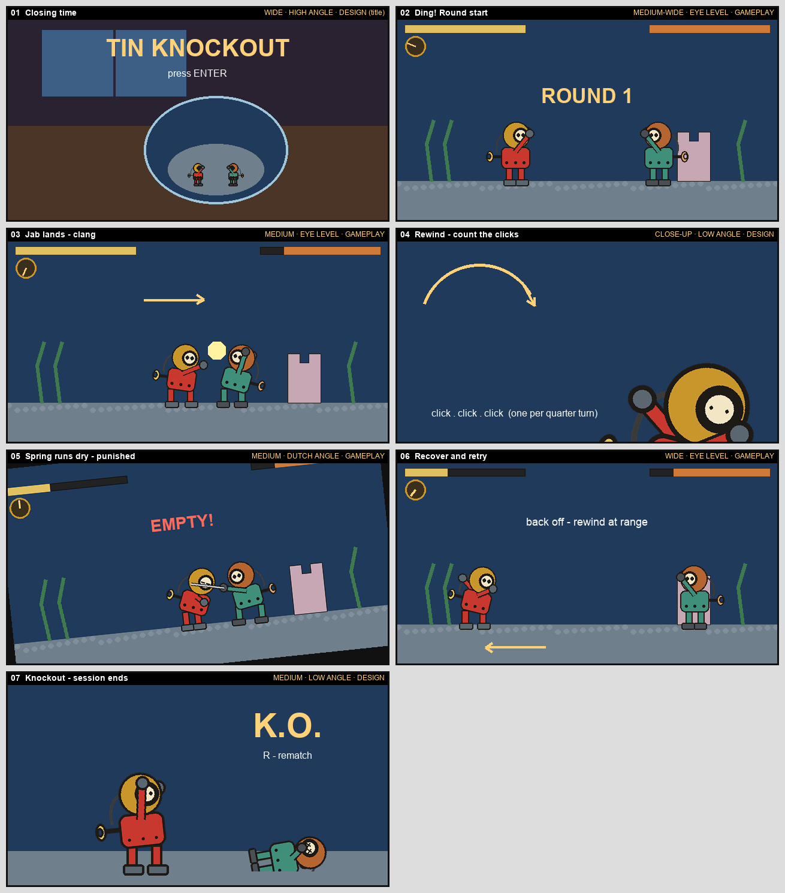

*Figure 7. The storyboard from Assignment 2: code-drawn panels that set the shot language (wide title, eye-level gameplay, a low-angle K.O., a Dutch angle when Bolt is knocked down). Story panels will reuse this language.*

---

## 7. Gameplay

### 7.1 Goal: why the player is playing

- **In the moment:** empty the other toy's health bar before they empty yours, in a best-of-3 bout.
- **Across the game:** climb the six nights of the Midnight Circuit, free each toy you beat, win the Golden Key and save the shop.
- **For mastery:** earn a Gold medal on every night (no retries, no rounds lost), then beat **Spring Steel** mode (no retries at all), finish the Workbench trials, and beat friends in Versus.

The fun is the gamble of the spring: the satisfying *clang* when a cutlass lands, and the tension of standing still and counting clicks while the opponent decides whether to rush you.

### 7.2 Game mechanics: what actions the player takes

| Action | Keyboard | Gamepad | Wind | What it does | Status |
|---|---|---|---|---|---|
| **Walk** | A / D or ← / → | D-pad | −3 per second | 110 px/s. **You turn to face the way you walk**, so backing off turns your back. | **Built** |
| **Jab** | J | X | −12 | 7 dmg. Fast: 0.07 s startup, 0.10 s active, 0.18 s recovery. Connects when the fighters' feet are less than 79 px apart. | **Built** |
| **Tin cutlass** | K | Y | −22 | 13 dmg, more reach: connects at less than 103 px. 0.14 / 0.12 / 0.30 s. | **Built** |
| **Cork pop-gun** | L | B | −30 | Fires one cork at 0.10 s: 320 px/s, 10 dmg, crosses the whole bowl in about 1.15 s. | **Built** |
| **Block** (hold) | I or ↑ | RB | 0 | Stops a hit from the **front only**: you take 20 % of its damage and a small push. Hits from behind land. | **Built** |
| **Rewind** (hold) | S or ↓ | LB | +10 per click | Crank the key at 360°/s: one click per quarter-turn, 4 clicks a second, 0 to 100 in 2.5 s. You can't move or block. | **Built** |
| **Hop** | Space | A | −8 | A short hop that clears corks, darts, the train and low sweeps | *Planned* (Night 3) |
| **Wind-Up Special** | K + L together | Y + B | −50 | One signature move per fighter (Section 7.3) | *Planned* |
| Pause / mute music / mute effects | Esc or P / M / N | Start | — | Music and effects mute separately | **Built** |
| Show hitboxes | F1 | — | — | Hurtboxes in green, hitboxes in red | **Built** |

**Rules that make the actions interesting** (all **Built**):

- **Wind is paid on the press.** A whiffed or blocked attack still costs its wind.
- **You can't spend wind you don't have.** At 0 wind you can't walk or attack; the only thing you can do is rewind.
- **Running dry is a stall.** When wind hits 0, Bolt slumps into **EMPTY** for 1.6 s and can't act.
- **Vulnerable states hurt more.** A hit while REWIND or EMPTY does **1.5× damage** and a **0.80 s knockdown** instead of the normal 0.32 s stun, with a bigger push and a camera roll.
- **One hit per swing.** An attack connects on its first overlapping frame and never again in the same swing; every hit has 0.07 s of hitstop.
- **Tin bodies don't pass.** Fighters push apart to a 44 px minimum gap, so you can't walk through someone to get behind them.

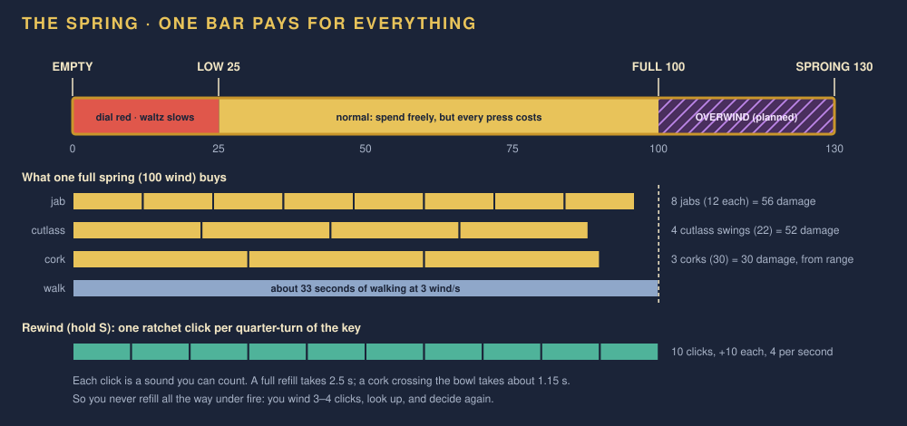

*Figure 8. The wind economy at true scale. One full spring buys 8 jabs, 4 cutlass swings, 3 corks, or 33 s of walking, and none of those adds up to a K.O.*

### 7.3 Abilities and power-ups

#### Abilities everyone has

| Ability | How it works | Why it is in the game |
|---|---|---|
| **Rewind** (**Built**) | Hold to crank; +10 per audible click. Release any time to keep what you have. | The core risk: wind comes back only when you choose to stop. |
| **Low-wind warning** (**Built**) | Below 25 wind the dial turns red and the waltz slows and drops in pitch, like a music box running down. It recovers when you rewind past 25. | You can feel the danger without looking at the HUD. |
| **Block** (**Built**) | Front only, 20 % chip. | Defense costs no wind but needs you to face the threat, which conflicts with backing off to rewind. |
| **Hop** (*Planned*, unlocked on Night 3) | 8 wind; a short arc of about 40 px. You can't attack or block in the air. | Lets you answer corks and hazards with timing instead of only blocking. Gives a way over Clatter's drum. |
| **Overwind** (*Planned*, unlocked on Night 4) | Keep holding Rewind at 100 and the key keeps turning, slower (2 clicks/s) and with a rising creak, up to 130. While above 100, your next attack does **×1.3 damage**. Overwind drains back to 100 at 5 wind/s. One click past 130 and the spring goes ***sproing***: instant EMPTY. | Rewards players who listen: the creak gets higher with every click, and you have half a second to let go. |
| **Wind-Up Special** (*Planned*) | K + L together, 50 wind. Bolt's is **Depth Charge**: he stamps his lead boots and a ring of bubbles knocks down anything within 90 px for 16 damage. Each fighter has one. | A big, expensive move that is only safe after you have read the opponent. |

#### Power-ups from the toy box (*Planned*)

The **toy box** (the Assignment 3 model) sits at the back of every arena from Night 2. Its lid pops open first at 15 s into a round, then every 20 s, and throws one pickup to one of three marked spots on the floor. Walk over a pickup to take it. A weapon pickup **replaces** your cutlass or pop-gun for a few uses, shown as pips under your dial, and then your own weapon comes back.

| Pickup | Looks like | Effect | Lasts |
|---|---|---|---|
| **Winding key** | A small brass key (the Assignment 3 model) | +40 wind instantly, no cranking | Instant |
| **Oil can** | A tin oil can with a long spout | All wind costs halved; Bolt drips oil | 8 s |
| **Tin mallet** | A big striped tin hammer | Replaces the cutlass: 26 wind, 20 dmg, slower (0.25 s startup), always knocks down | 3 swings |
| **Tin shield** | A round painted shield | Blocks from **both** sides with no chip damage | 3 blocks |
| **Spring-dart pistol** | A tiny tin pistol | Replaces the pop-gun: 18 wind, 6 dmg, faster darts (480 px/s) | 5 shots |
| **Golden Key** | The Ringmaster's cane | Unlimited wind | 10 s, boss phase 3 only |

Pickups are a reason to move instead of turtling, and a second thing to fight over. The opponent's AI goes for pickups too, and you can see which pickup is coming because the lid rattles and shows it for 1 s before the throw.

### 7.4 Levels and challenges

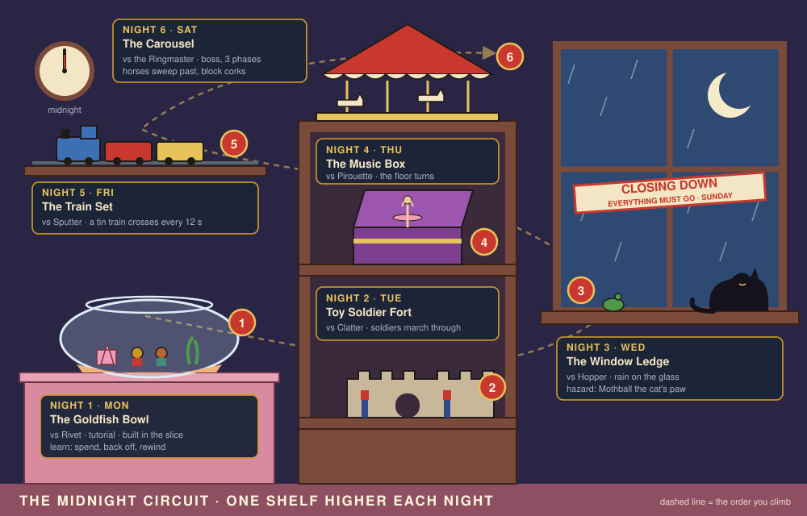

*Figure 9. The night map: a cross-section of Pell's Toys & Curios. Each night is one shelf higher, and each arena is a real place in the shop.*

| Night | Arena | Opponent | What it teaches | Arena hazard | Unlocked after winning |
|---|---|---|---|---|---|
| **1 · Mon** | **The Goldfish Bowl** on the counter (**Built**) | Rivet | Spend, back off, rewind. Punish the opponent who stops to wind. | None (the sunken castle is scenery) | Winding-key pickups |
| **2 · Tue** | **Toy Soldier Fort**, bottom shelf | Clatter | Defense has a cost: make him drum himself empty | A line of three marching tin soldiers crosses every 15 s and pushes anyone in its way 60 px | Tin mallet pickup; Clatter in Versus |
| **3 · Wed** | **The Window Ledge**, in the rain | Hopper | Timing and the new **Hop**: don't throw corks he can hop | **Mothball's paw**: a shadow appears 1.5 s before a swipe that knocks down anything in a 160 px zone. The wet ledge makes you skid 12 px when you stop. | Oil can; Hopper in Versus |
| **4 · Thu** | **The Music Box** on the middle shelf | Pirouette | Patience: block, wait for EMPTY, punish. New: **Overwind**. | The music-box drum turns, slowly pulling both fighters right at 20 px/s; the comb at the right edge plucks you back | Pirouette in Versus |
| **5 · Fri** | **The Train Set** on the top wall shelf | Sputter | Closing distance against a zoner | A tin train crosses every 12 s: 12 dmg and a knockdown unless you hop or block. The whistle and headlight warn 1.5 s ahead. | Tin shield, dart pistol; Sputter in Versus |
| **6 · Sat** | **The Carousel** on top of the tall cabinet | The Ringmaster (boss) | Everything at once | Carousel horses sweep across the foreground every 10 s and stop corks | The ending; the Ringmaster in Versus; Spring Steel mode |

**The boss fight, in three phases:**

1. **Ringmaster (100 → 60 % health).** Whip and top-hat throws. The Golden Key cane keeps him wound, so he never has to rewind. You can't out-wind him; you have to out-read him.
2. **Monkeys (60 → 30 %).** The two cymbal monkeys sit on the carousel and clash every 6 s. The clash is a shock wave that knocks down anyone who isn't blocking. Rivet appears and throws Bolt a winding key.
3. **The Key breaks loose (below 30 %).** The cracked Golden Key falls into the arena as a pickup. Whoever grabs it has unlimited wind for 10 s. From now on the Ringmaster runs down like everyone else.

**How difficulty rises.** Each night adds exactly one new idea (a new opponent pattern, one hazard, and sometimes one new player ability) and tests the ideas before it. Opponents also get faster at punishing: Rivet waits 0.75 s between attacks; the Ringmaster waits 0.40 s.

**Extra challenges:**

- **Workbench trials:** *Count the Clicks* (refill exactly 30 wind with the dial hidden) · *Cork Duel* (K.O. Rivet with corks only) · *Tight Spring* (win a bout spending under 300 wind) · *Punisher* (land 5 hits on an EMPTY opponent in one bout) · *No Peeking* (a whole bout with the dials hidden).
- **Spring Steel mode:** the six nights in a row with no retries.
- **Versus:** any two unlocked fighters on any unlocked arena, local 2 players.

### 7.5 Losing or restarting

| Situation | What happens |
|---|---|
| **Your health reaches 0** | You lose the **round** (K.O.). Bolt lies flat with X-eyes, the bell rings, the music stops. **Built** |
| **The shop clock runs out** | The round goes to whoever has the higher health percentage; a tie means a sudden-death round. *Planned* |
| **You lose 2 rounds** | You lose the **bout** and see the "Wound down" screen: **Rewind** (retry the bout from round 1, unlimited), go back to the night map, or quit. *Planned* (the slice offers R / Enter for a rematch: **Built**) |
| **Restart on purpose** | Pause → Restart bout. A manual restart doesn't count as a loss, but it does cost the night's Gold medal. *Planned* |
| **Spring Steel mode** | One lost bout ends the run and sends you back to Night 1. *Planned* |
| **Double K.O.** | The round is replayed. *Planned* |

Story mode never locks you out: retries are unlimited, and the cost of retrying is only the medal. **Gold** = won with no retries and no rounds lost; **Silver** = no retries; **Brass** = won.

**What is not a loss:** running out of wind. EMPTY is a punishable stall, never a defeat. A round can only be lost through health or the clock, so the spring always stays a risk you choose to take.

### 7.6 Player skills: what a good player is good at

| Skill | What a good player does | Where the game teaches it | How the game rewards or measures it |
|---|---|---|---|
| **Wind budgeting** | Never presses into EMPTY. Keeps about 25 wind in reserve for a punish. | Night 1 (Rivet's own retreat at 25 shows the idea) | Medals; *Tight Spring* trial |
| **Spacing** | Stands just outside jab range (79 px), steps in for a cutlass (103 px), and knows bodies stop at 44 px | Night 1, then Hopper's long tongue on Night 3 | Damage taken |
| **Safe rewinding** | Rewinds only at range (over about 230 px) or while the opponent is stalled. Winds 3–4 clicks, looks up, decides again. | Every night; the knockdown penalty | Fewer 1.5× knockdowns |
| **Listening** | Counts ratchet clicks instead of watching the dial; hears the waltz slow down; hears the overwind creak | The click sound, low-wind music, overwind | *Count the Clicks* and *No Peeking* trials |
| **Reading tells and punishing** | Watches the opponent's dial and pose and attacks when they are recovering, rewinding or EMPTY | Each opponent's tell (Section 5) | *Punisher* trial; faster wins |
| **Facing discipline** | Backs off, then taps toward the opponent to face them before blocking (walking away turns your back, and blocks only work in front) | Night 1; Clatter's drum on Night 2 | Fewer hits taken from behind |
| **Timing** | Hops corks, the train and the cat's paw on the warning, not after | Nights 3–5 | Hazard hits taken |
| **Resource fights** | Times the toy box, grabs the right pickup, denies the opponent the one they need | Nights 2–6 | Wins; the Golden Key in phase 3 |

---

## 8. Graphics and Styling

**Style in one line:** a painted, side-view illustration of mid-century tin toys: chunky proportions, clean dark outlines, flat enamel colours with a little wear, in a toy shop at night. **Not** pixel art and **not** photo-real.

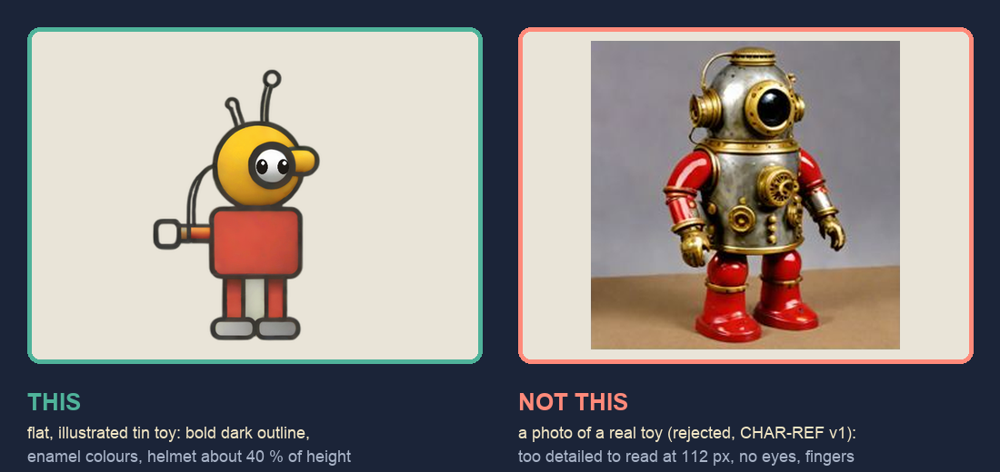

*Figure 10. This, not that. Left: the accepted Bolt sprite. Right: the first generated batch, which looked like photos of real toys and was rejected because it was too detailed to read at 112 px, had no eyes and had fingers.*

### What it looks like in the game today

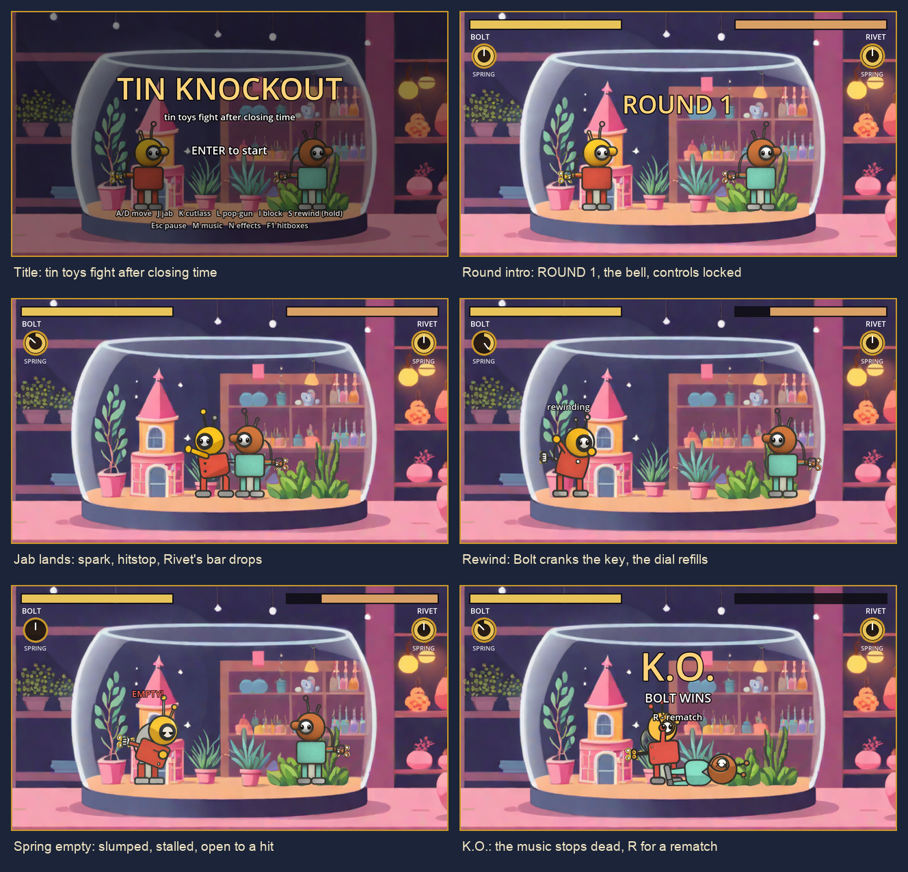

*Figure 11. Six real engine captures from the Assignment 2 slice, one per storyboard beat.*

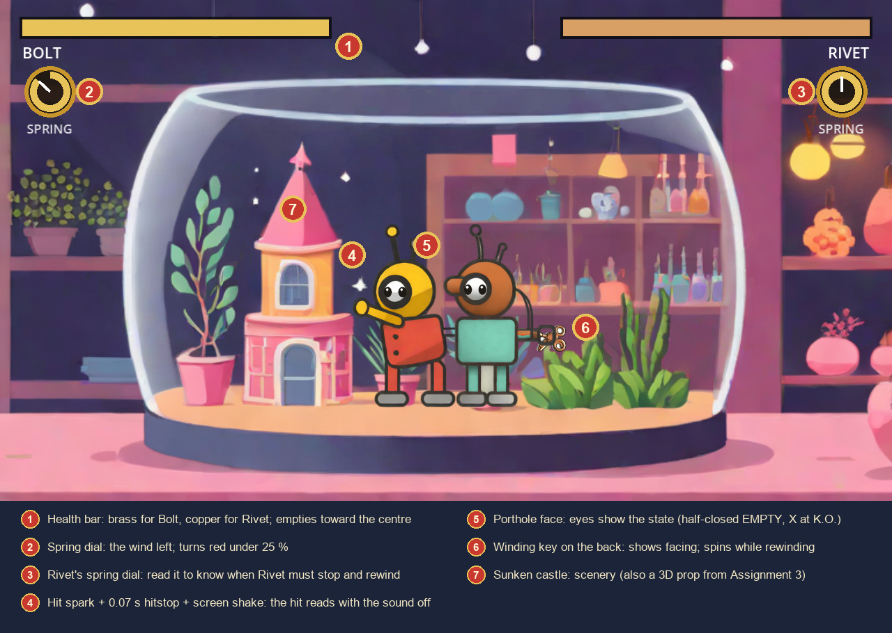

*Figure 12. Everything the player needs is visible with the sound off. The HUD is code-drawn on its own canvas layer, so camera shake never moves it.*

### Colour

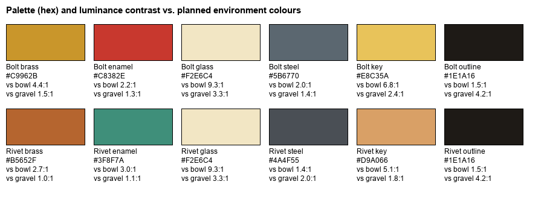

*Figure 13. The character palette. Rivet is the same art with copper, verdigris and dark-steel swaps.*

Each arena gets three anchor colours, and a cool blue moonlight rim on the fighters ties all six together:

| Arena | Anchor colours |
|---|---|
| Goldfish Bowl | counter pink `#E7A3B6` · sand `#F0B27A` · shop violet `#2B2545` |
| Toy Soldier Fort | shelf wood `#7A4B3A` · fort stone `#C9B79A` · coat navy `#2F4A8A` |
| Window Ledge | night glass `#2E4A72` · moon `#F5EBC8` · rain `#9DB8DA` |
| Music Box | velvet `#7E3F8F` · brass `#E8C35A` · tutu pink `#F29BB8` |
| Train Set | tin blue `#3D6FB5` · signal red `#C8382E` · track steel `#5B6770` |
| Carousel | canopy red `#C8382E` · cream `#F2E6C4` · gold `#E8C35A` |

**An art-direction decision.** The concept planned a cool, moonlit blue shop. The generated goldfish-bowl background came out warm pastel pink instead, and every asset now matches it. The full game **keeps the warm pastel look** and brings in the night through blue rim light, window glow and darker upper walls, rather than repainting what works.

### Character art rules (every fighter, every pose)

1. **Silhouette first.** Each fighter must read as a solid black shape at 112 px tall: Bolt by his round helmet and antennae, Clatter by his tall hat and drum, Hopper by his squat body, Pirouette by her tutu, Sputter by his boxy head, the Ringmaster by his top hat and cane.
2. **The key is always on the back.** It shows facing and spins during rewind.
3. **One dark outline, about 2 px at game size**, flat enamel colours, a little chipped paint. Materials are tin and brass, never fabric or rubber.
4. **Faces are simple:** two eyes and nothing else for the divers. Eyes change for EMPTY (half-closed) and K.O. (X).
5. **Mitten hands, no fingers.** Weapons are separate sprites attached to a hand anchor.
6. **Contrast check before generating.** The slice found that Rivet's verdigris suit almost vanished against the planned gravel (1.07:1), and Bolt's helmet against the pink castle is 1.02:1. Every new fighter is checked against its arena's colours first.

### Camera, resolution and game feel

| | |
|---|---|
| **Resolution** | 640×360 viewport, scaled ×2 to a 1280×720 window (×6 for 4K film capture) |
| **Camera** | Fixed side view of the whole arena; no zoom during play |
| **Fighter scale** | Bolt is 112 px tall, 31 % of the screen height |
| **Hit feel** (**Built**) | 0.07 s hitstop, ±3 px screen shake for 0.15 s, a 16-point star spark, a 5° Dutch-angle camera roll on a knockdown |
| **Animation** | One strong static pose per state, swapped instantly. Motion comes from movement, pushback, shake and the spinning key. Planned: 2-frame squash on hits and a 3-frame walk. |

The 3D props from Assignment 3 (Figure 4) are rendered to sprites from the fight camera's angle, so they match the 2D art and light.

---

## 9. Music and Sound Effects

**Audio direction:** mechanical weight with toy-box humour. Hits sound solid and satisfying, but everything sounds small and made of metal, never like real violence.

### Music

The whole game uses one melody, the **shop waltz** (the slice's loop), arranged differently for each place in the shop.

| Where | Arrangement | Status |
|---|---|---|
| Title | The waltz, quiet (−14 dB), as if from a music box on another shelf | **Built** |
| Night 1 · Goldfish Bowl | The waltz at full volume, looping seamlessly | **Built** |
| Night 2 · Toy Soldier Fort | The melody as a march in 2/4: snare drum and fife | *Planned* |
| Night 3 · Window Ledge | A slow waltz on celesta, with rain on the glass | *Planned* |
| Night 4 · Music Box | Played on the music box's own comb, plucked and bright | *Planned* |
| Night 5 · Train Set | A chugging ragtime version with train-rhythm percussion | *Planned* |
| Night 6 · Carousel | A carnival band organ playing the waltz in a minor key at 1.5× tempo; in phase 3 it drops to a lone music box | *Planned* |
| Win / lose stings | Win: the bell and three rising music-box notes. Lose: the music box winding down to a stop. | *Planned* |
| Ending | The waltz in a major key, full, ending on the shop door's bell at dawn | *Planned* |

**Music that reacts to the fight** (**Built**, `audio/music.gd`):

| Moment | What the music does |
|---|---|
| Round start | The bell, then the waltz starts from the top |
| Your spring below 25 % | The waltz slows and drops in pitch (pitch scale 0.85 over 0.6 s), like a music box winding down. It recovers when you rewind past 25. |
| Pause | A low-pass filter and 10 dB quieter, as if heard from underwater |
| K.O. | The music **stops dead** with the bell. Silence until the rematch. |

### Sound effects

| Sound | When it plays | Material / feel | Status |
|---|---|---|---|
| Round bell | Round start and K.O. | A small brass shop bell | **Built** |
| Jab | A jab connects | A hollow tin *clang* | **Built** |
| Cutlass | A cutlass swing connects | A metallic *shing* | **Built** |
| Cork pop | The pop-gun fires | A cork *pop* | **Built** |
| Rewind click | Every quarter-turn of the key (+10 wind) | A ratchet click you can count | **Built** |
| Spring empty | Entering EMPTY | A falling *wrrr-clunk* | **Built** |
| Block | A hit is blocked | A dull tin *thunk* with a scrape | *Planned* |
| Hop / landing | Hop and land | A short spring *boing*, then a tin tap | *Planned* |
| Overwind creak / sproing | Each click past 100; breaking past 130 | A creak that rises in pitch; a twangy coil release | *Planned* |
| Knockdown | A 0.8 s knockdown | A tin rattle and bounce | *Planned* |
| Toy box | The lid opens; a pickup lands | A hinge creak and a jack-in-the-box *pop* | *Planned* |
| Pickups | Grabbing each pickup | A small chime; the winding key is three fast clicks | *Planned* |
| Hazards | Each warning and hit | Marching drum; cat purr turning into a hiss; train whistle and clatter; carousel organ; cymbal clash | *Planned* |
| UI | Menu move, select, back | Clock tick; bell ding; a key turning | *Planned* |
| Ambience | Under each arena | Shop clock ticking, rain on glass, the music-box comb | *Planned* |

### Audio rules (**Built**, kept for every new sound)

1. **Sound never decides game state.** Gameplay sends signals and the audio code listens; a muted or missing sound changes nothing that happens. A test runs the same fight muted and unmuted and checks the end state is identical.
2. **Exactly one sound per event.** Held buttons and repeated states never re-trigger a sound.
3. **Readable with the sound off.** Every sound confirms something already on screen.
4. **Separate buses and mutes:** Music (M) and SFX (N).

**How the audio was made:** the 6 sound effects were generated with AudioLDM 2 and the music with MusicGen-small, both run locally, then trimmed, pitched and cut into a bar-aligned loop by scripts in `tools/edit/` (`check_seam.py` checks the loop seam). Both models are licensed for non-commercial use only, which is fine for coursework. The current sounds were chosen by signal analysis rather than by ear, so a listening pass is part of every playtest.

---

## 10. Technical Description

### Platform and engine

| | |
|---|---|
| **Engine** | Godot **4.7.2** stable, GDScript only, no plugins, no .NET |
| **Renderer** | GL Compatibility, so it runs on integrated GPUs and can be exported to the web |
| **Targets** | macOS (development machine: Apple M4, macOS 15.6) and Windows. Web export is a stretch goal. |
| **Display** | 640×360 viewport, `canvas_items` stretch mode, 1280×720 default window |
| **Input** | Keyboard and gamepad. Actions are registered in code by an autoload (`game/controls.gd`), so all bindings are in one readable file. Planned: player 2 bindings and rebinding. |
| **Simulation** | Fixed 60 Hz physics step; the whole fight runs inside `_physics_process` |

### Architecture

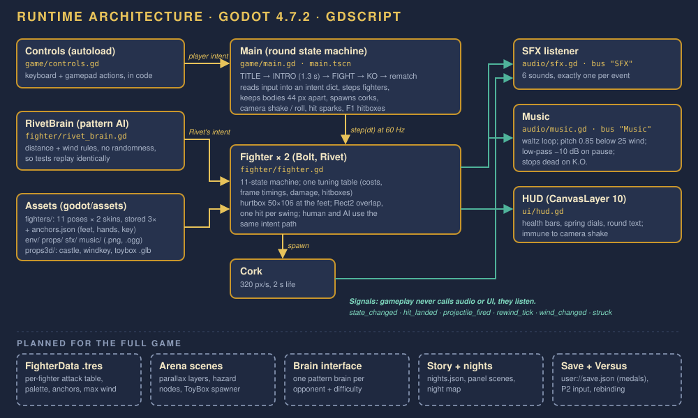

*Figure 14. How the slice is built (top) and what the full game adds (bottom, dashed).*

- **Main (`game/main.gd`)** owns the round state machine (TITLE → INTRO → FIGHT → KO), reads the player's input into an `intent` dictionary, asks Rivet's brain for its intent, steps both fighters, keeps their bodies apart, spawns corks, and runs camera shake, roll and sparks.
- **Fighter (`fighter/fighter.gd`)** is one class for every fighter. All tuning (costs, frame timings, damage, hitboxes) lives in one table at the top of the file. A human, the AI or a second player all control a fighter the same way, by filling in its `intent`, so a new controller never needs new fighter code.
- **Combat** uses plain `Rect2` overlap: a 50×106 hurtbox at the feet and an attack box that is only live during the attack's active window. One hit per swing, then hitstop.
- **Audio and UI listen to signals** (`state_changed`, `hit_landed`, `projectile_fired`, `rewind_tick`, `wind_changed`, and the cork's `struck`). Gameplay never calls them, which is why the muted and unmuted runs can be compared in tests.
- **Art** is stored at 3× game size. Each pose has a feet anchor, hand anchors for weapons and a back anchor for the key in `assets/fighters/anchors.json`. Left-facing art is a runtime flip.

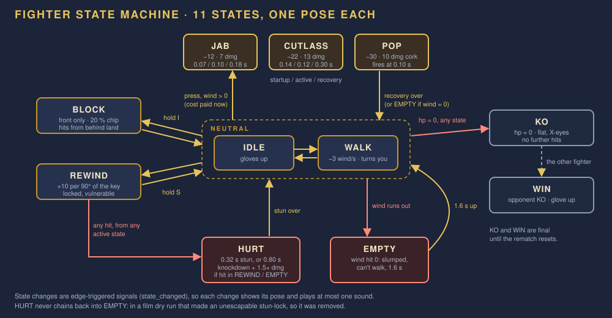

*Figure 15. The fighter state machine: 11 states with one pose each.*

### What the full game adds

| System | Plan |
|---|---|
| **FighterData resources** | One `.tres` file per fighter: attack table, max wind, palette, anchors, special move. `fighter.gd` reads it instead of constants. |
| **Arena scenes** | One scene per arena: parallax background layers, floor height and bounds, one hazard node with its warning timer, and a toy-box spawner. |
| **Brain interface** | `think(dt)` fills `intent`, as Rivet's brain already does. One deterministic pattern brain per opponent, with a difficulty setting that changes reaction delay, not rules. |
| **Story and nights** | `nights.json` lists each night's arena, opponent, panels and unlocks; one small scene shows the panels; the night map reads the save file. |
| **Save** | `user://save.json`: medals, unlocks, trial results, options |
| **Versus** | Player 2 input set (second keyboard half or second gamepad), character and arena select |

### Project layout

```
godot/
  project.godot          640x360, GL Compatibility, main scene = game/main.tscn
  game/                  main.gd, main.tscn, controls.gd (input autoload)
  fighter/               fighter.gd, rivet_brain.gd, cork.gd
  audio/                 sfx.gd, music.gd   (buses in default_bus_layout.tres)
  ui/                    hud.gd
  assets/                fighters/ env/ props/ props3d/ sfx/ music/
  prop_room/             prop_room.tscn     (Assignment 3 props)
  tests/                 test_slice.gd, check_props3d.gd
  tools/                 film capture and prop render scripts
tools/                   gen/ edit/ blender/ gdd/   (generation, edits, 3D, this GDD)
```

### Testing

- **`tests/test_slice.gd`**: 25 headless checks that drive the real input path, including one jab = one hit = one sound, a held jab is one attack, rewinding plays one click per 10 wind and none once full, EMPTY plays its sound once, facing follows input, and a muted run ends in the same state as an unmuted one. Result at `64c037a`: **25 checks, 0 failed** (TEST-REPORT.md).
- **`tests/check_props3d.gd`**: checks that the three 3D props import, match their planned size, stand on the floor and stay within their triangle budgets. Result: **PASS (0 failing)**.
- Because the AI has no randomness, every new opponent gets a scripted replay test. Every new fighter also gets a frame-data test that compares its costs and timings with its FighterData file.

```bash
godot --headless --path godot --script res://tests/test_slice.gd
```

### Asset pipeline

| Asset | How it is made |
|---|---|
| Fighter poses | A code-drawn spec sketch → SDXL-Turbo img2img (strength 0.6, one fixed seed per fighter, after one accepted reference image) → background removal (rembg) → scripted edits (eyes, trims) → recoloured variants. Every generation is logged in ASSET-LOG.md. |
| Backgrounds and props | SDXL-Turbo, then scripted cleanup; 3D props built from primitives in Blender 5.2.2 and exported as `.glb` |
| Audio | AudioLDM 2 (effects) and MusicGen-small (music), run locally; trim, pitch and loop scripts in `tools/edit/` |
| GDD figures | Hand-written SVG diagrams in `design/gdd/`; raster figures built from existing art by `tools/gdd/make_figures.py` |

### Performance targets

A steady 60 fps on an integrated GPU at 1280×720, with all six arenas under 150 MB of memory. With two fighters, at most a few projectiles and one hazard on screen, this has a lot of headroom. Both numbers are targets, not measurements yet.

### Scope and priorities

| Priority | Content |
|---|---|
| **P0: a complete small game** | Nights 1–3 with Rivet, Clatter and Hopper; best-of-3 bouts with the clock; Hop; winding-key and mallet pickups; night map and story panels; medals and save; three music arrangements |
| **P1: the full story** | Nights 4–6 with Pirouette, Sputter and the Ringmaster; Overwind; the remaining pickups; the ending; Versus mode |
| **P2: polish and extras** | Wind-Up Specials, Workbench trials, Spring Steel mode, rebinding, web export |

### Risks

| Risk | What could go wrong | Plan |
|---|---|---|
| **Character consistency** | The image model drew a different diver for every seed until the process was fixed (predicted failure F1, confirmed in Assignment 2) | Use the same process for every new fighter: one accepted reference, img2img at 0.6 strength with one seed, recolours where possible. Budget one day per fighter. |
| **Fair AI** | Pattern opponents can feel either cheap or brainless | Every opponent has a visible tell; no randomness, so problems can be reproduced; at least two outside playtesters per night |
| **Scope** | Six fighters and six arenas is a lot for one semester | P0 alone (three nights) is a finished game |
| **Readability** | Low-contrast fighters on busy backgrounds (Bolt's helmet vs the pink castle is 1.02:1) | Measure contrast before generating; add a rim light; move scenery out of the fighters' height band |
| **Licences** | SDXL-Turbo, MusicGen and AudioLDM 2 allow non-commercial use only | Fine for coursework. Any public release would need new art and audio from permissively licensed tools or made by hand. |

---

*Sources and credits for every existing asset are in [SOURCES.md](SOURCES.md) and [ASSET-LOG.md](ASSET-LOG.md). This GDD was drafted with Claude Code (Opus 5.5) from my existing design documents and the game's code. The full-game additions (the story, the five new fighters, Nights 2–6, the pickups, Hop, Overwind and the specials) are proposals for me to review and playtest before I build them.*
