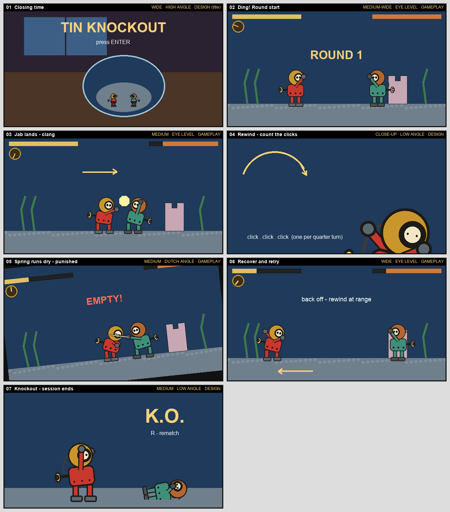
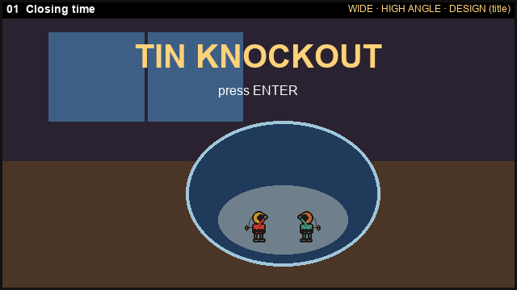
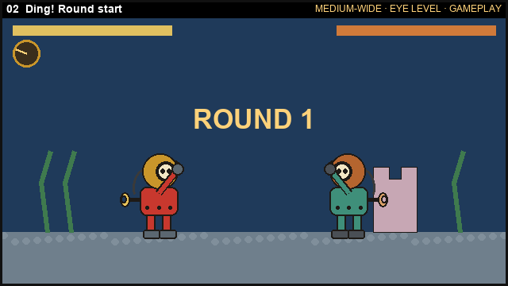
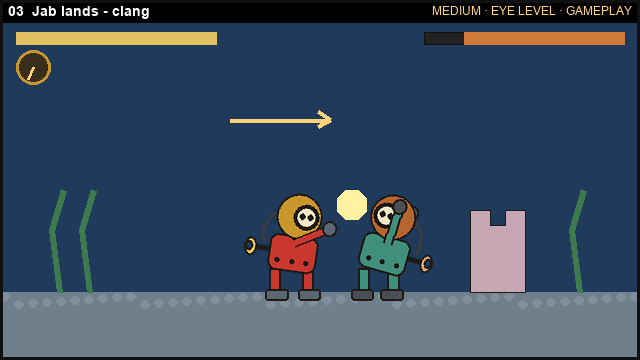
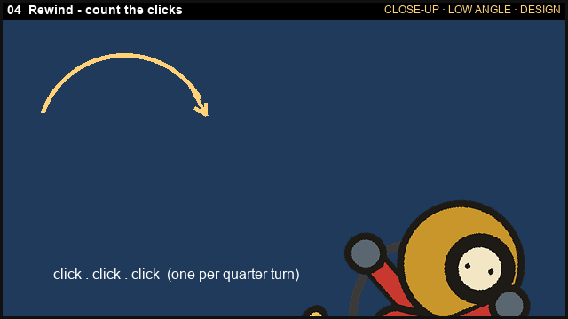
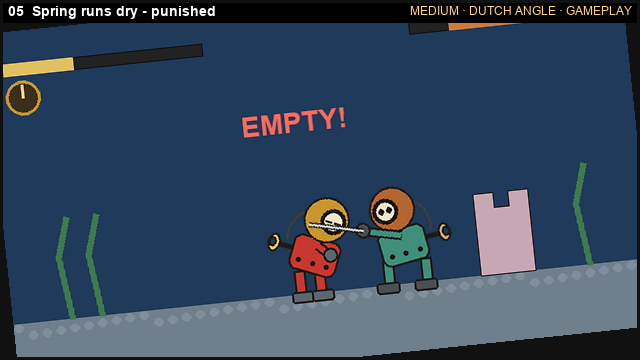
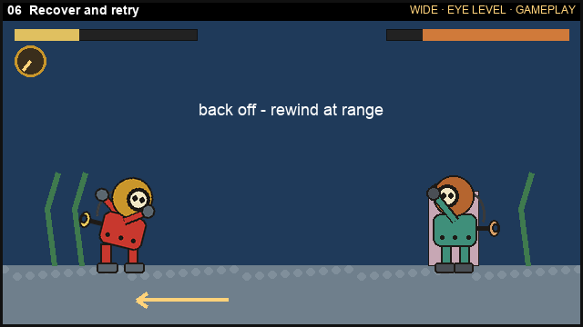
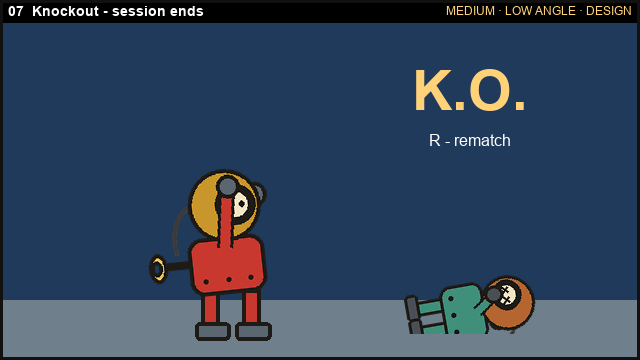

# Storyboard — Tin Knockout

*Version 1 · 2026-10-05 · committed before any generation. Frame shape: **16:9** throughout (640×360 thumbnails = the game viewport). Thumbnails are Claude-drawn code sketches (`design/draw_design.py`) used as the spec; they are not generated assets.*

**Views used:** wide (01, 06) · medium-wide / medium (02, 03, 05, 07) · close-up (04)
**Angles used:** high angle (01) · eye level (02, 03, 06) · low angle (04, 07) · Dutch / tilted (05)
**Gameplay vs design:** 02, 03, 05 and 06 show what the game camera actually shows. 01, 04 and 07 are design views that set the feel (title, a detail shot, the ending).

---

## Panel 1 — Closing time

- **Shot:** wide · high angle (looking down at the counter) · **design view** (title screen)
- **Player action:** sees the title, presses Enter; the game loads the arena
- **See:** the dark toy shop, moonlight through the window, the goldfish bowl on the counter with two tiny tin fighters inside; title text
- **Hear:** the waltz starts quietly, as if from a music box on another shelf (MUS-WALTZ playing, low volume)
- **Assets:** ENV-BOWL, CHAR-IDLE, RIVET-IDLE, MUS-WALTZ
- **Design reason (pillar *Toys after closing*):** establish that this is a secret world of toys at night before any fighting happens.

## Panel 2 — Ding! Round start

- **Shot:** medium-wide · eye level · **gameplay view**
- **Player action:** waits for the bell; control unlocks after "ROUND 1"
- **See:** Bolt (left, facing right) and Rivet (right, facing left) in idle stance; full health bars; Bolt's spring dial full
- **Hear:** SFX-BELL once; the waltz comes in at full volume
- **Assets:** ENV-BOWL, CHAR-IDLE, RIVET-IDLE, SFX-BELL, MUS-WALTZ, UI (code-drawn)
- **Design reason (pillar *Read the fight at a glance*):** everything the player needs (health, wind, facing) is visible before the first move.

## Panel 3 — Jab lands

- **Shot:** medium · eye level · **gameplay view**
- **Player action:** walks in and presses Jab; the game checks the hitbox, applies damage, and drains a little wind
- **See:** CHAR-JAB with the fist extended; a hit spark; Rivet in its hurt pose; Rivet's health drops; Bolt's spring dial ticks down
- **Hear:** SFX-JAB (hollow tin *clang*), exactly once per jab; music continues
- **Assets:** CHAR-WALK, CHAR-JAB, RIVET-HURT, SFX-JAB, MUS-WALTZ
- **Design reason (pillar *Every move costs wind*):** a hit feels good, but the dial dropping says it wasn't free.

## Panel 4 — Rewind: count the clicks

- **Shot:** close-up · low angle · **design view** (a detail shot for the film and the feel; the gameplay camera stays wide)
- **Player action:** holds Rewind; Bolt cranks his key and the spring fills
- **See:** the key turning in Bolt's glove, his hunched pose (CHAR-REWIND)
- **Hear:** SFX-REWIND, one ratchet click per quarter-turn, so the player can count the wind going in; music continues
- **Assets:** CHAR-REWIND, SFX-REWIND
- **Design reason (pillar *Every move costs wind*):** the core resource has a physical, audible source.

## Panel 5 — Spring runs dry

- **Shot:** medium · **Dutch angle** (the gameplay camera rolls about 5° during a knockdown shake) · **gameplay view**
- **Player action:** spent too much wind attacking; the spring hits zero; Rivet swings and connects
- **See:** CHAR-EMPTY (slumped, half-closed eyes), then CHAR-HURT; "EMPTY!" text; dial at zero; health drops
- **Hear:** SFX-EMPTY (a falling *wrrr-clunk*) once on entering empty; SFX-CUTLASS on Rivet's hit; **the waltz slows and drops in pitch** while the spring is below 25 %
- **Assets:** CHAR-EMPTY, CHAR-HURT, RIVET-CUTLASS, WPN-CUTLASS, SFX-EMPTY, SFX-CUTLASS, MUS-WALTZ
- **Design reason (pillar *Every move costs wind*):** the player should know exactly why they got punished (greed) and want to try again more carefully.

## Panel 6 — Back off and rewind

- **Shot:** wide · eye level · **gameplay view**
- **Player action:** walks away from Rivet, then holds Rewind at a safe distance; fires the pop-gun to keep Rivet away
- **See:** CHAR-WALK (retreating, still facing Rivet), then CHAR-REWIND; the dial refills; a cork projectile in flight (CHAR-POP, PROP-CORK)
- **Hear:** SFX-REWIND clicks; SFX-POP on firing; the waltz returns to normal tempo as the spring passes 25 %
- **Assets:** CHAR-WALK, CHAR-REWIND, CHAR-POP, WPN-POPGUN, PROP-CORK, SFX-REWIND, SFX-POP, MUS-WALTZ
- **Design reason (pillar *Every move costs wind*):** recovery is a skill: distance makes rewinding safe.

## Panel 7 — Knockout

- **Shot:** medium · low angle (hero shot) · **design view** (the gameplay version is the same moment at eye level)
- **Player action:** lands the final hit; the round ends; R starts a rematch
- **See:** CHAR-WIN (glove raised), Rivet in RIVET-KO with X-eyes, "K.O." text, the rematch prompt
- **Hear:** SFX-BELL (the KO bell); **the music stops dead**; silence until rematch
- **Assets:** CHAR-WIN, RIVET-KO, SFX-BELL, MUS-WALTZ (stopped)
- **Design reason (pillar *Toys after closing*):** the silence after the bell makes the win land, and the toys go still again.

*If Bolt is the one knocked out, the mirror of this panel plays: CHAR-KO, the bell, the music stops, and "R - rematch".*
